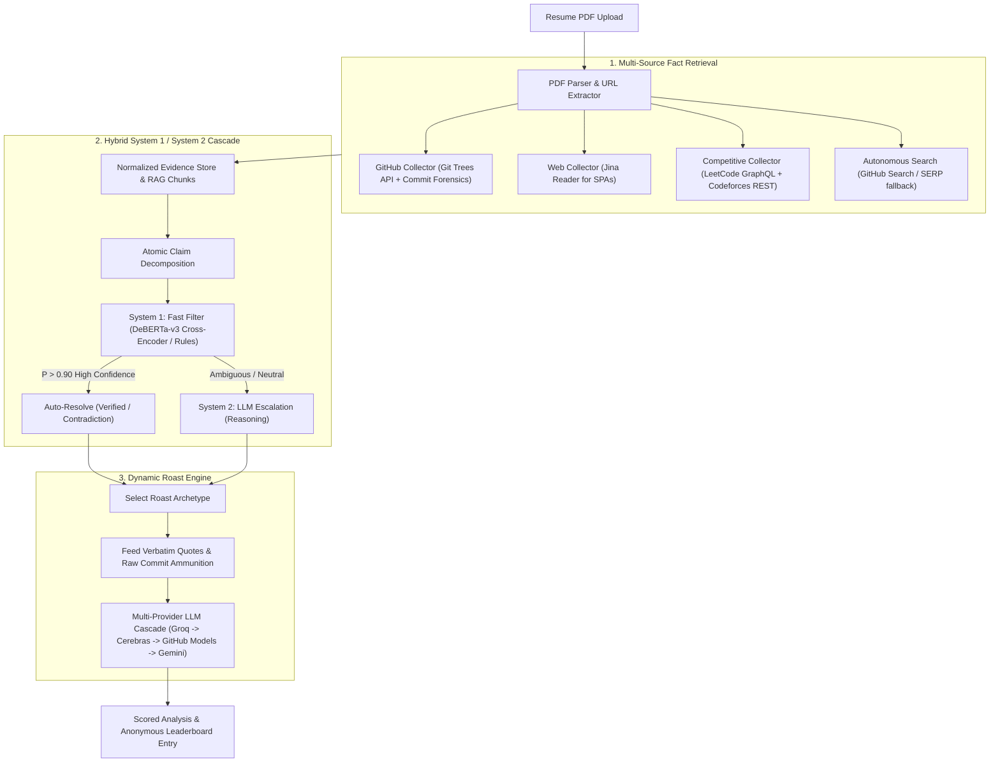

# doyoularp: Production Upgrade Roadmap & Checklist

This document consolidates all architectural enhancements, forensic upgrades, and feature additions discussed for the `doyoularp` claim verification and roast engine into an executable implementation checklist.

---

## Architecture Blueprint (Target State)

---

## Phase 1: Fact Retrieval & Collector Hardening

- [x] **1.1 Fix Client-Side Rendered (SPA) Webpages**
  - **Target:** `backend/app/collectors/web_collector.py`
  - **Action:** Replace/augment plain `httpx` + `BeautifulSoup` with Jina Reader (`https://r.jina.ai/<url>`) or a headless DOM reader to extract full text from Next.js, React, and Vue developer portfolios.
  - **Acceptance Criteria:** SPAs no longer return empty `

` strings.

- [x] **1.2 Monorepo & Branch Discovery via Git Trees API**
  - **Target:** `backend/app/collectors/github_collector.py`
  - **Action:** Replace hardcoded `NESTED_DIRS` path guessing with a single call to GitHub's recursive Git Trees endpoint: `GET /repos/{owner}/{repo}/git/trees/{default_branch}?recursive=1`.
  - **Acceptance Criteria:** Automatically locates `package.json`, `Cargo.toml`, `go.mod`, and `Dockerfile` regardless of monorepo nesting (`packages/*`, `apps/*`).

- [x] **1.3 GitHub Token Rotation & Evidence Caching**
  - **Target:** `backend/app/collectors/github_collector.py`, `backend/app/core/config.py`
  - **Action:** Support multiple GitHub tokens in `.env` rotated in round-robin to avoid 403 rate limits. Cache repository analysis by `f"{owner}/{repo}:{pushed_at}"`.
  - **Acceptance Criteria:** Concurrent resume uploads do not trigger GitHub API rate limit errors; unchanged repos load in 0ms.

- [x] **1.4 Autonomous Project Search (Unlinked Projects)**
  - **Target:** `backend/app/services/pipeline_service.py`
  - **Action:** When an extracted project claim has no attached URL, execute a scoped query to GitHub's Search API (`GET /search/repositories?q={project_name}+user:{candidate_github}`).
  - **Acceptance Criteria:** Candidate repos mentioned by name without explicit hyperlinks are discovered and verified.

- [x] **1.5 Remove Fatal Hardcoded "No GitHub" Abort**
  - **Target:** `backend/app/services/pipeline_service.py` (lines 215–289)
  - **Action:** Remove the immediate abort that assigns an automatic 100% LARP score. Allow the pipeline to process public web projects, competitive programming profiles, and mark private enterprise experience as `UNSUBSTANTIATED_PRIVATE_PROVENANCE` rather than instant fraud.

---

## Phase 2: Multi-Platform Verification (LeetCode, Codeforces, LinkedIn)

- [x] **2.1 Implement Competitive Programming Collector**
  - **Target:** `backend/app/collectors/competitive_collector.py` (New file)
  - **Action:**
    - **Codeforces:** Query public REST API (`GET https://codeforces.com/api/user.info?handles={handle}`) for peak rating, current rating, and rank.
    - **LeetCode:** Query public GraphQL endpoint (`https://leetcode.com/graphql`) for submission stats broken down by difficulty (Easy, Medium, Hard), contest rating, global ranking, and badges.
  - **Acceptance Criteria:** Free, zero-auth data retrieval for any candidate handle found in resume.

- [x] **2.2 URL Classification & Extraction for New Platforms**
  - **Target:** `backend/app/parsers/url_extractor.py`, `backend/app/parsers/pdf_parser.py`
  - **Action:** Add regex patterns to detect and normalize `leetcode.com/<username>`, `codeforces.com/profile/<handle>`, and plain text handles (e.g. `LeetCode: @john_doe`).

- [x] **2.3 LinkedIn Verification via Search SERP Snippet**
  - **Target:** `backend/app/collectors/linkedin_collector.py` (New file)
  - **Action:** Query Google/Bing SERP (via Tavily, Serper, or Custom Search) for `site:linkedin.com/in/{handle} OR "{Candidate Name}" "{Claimed Company}"` to confirm current company and title without triggering LinkedIn's authwall.

- [x] **2.4 Wire Evidence into Pipeline RAG Store**
  - **Target:** `backend/app/services/pipeline_service.py`
  - **Action:** Persist LeetCode, Codeforces, and LinkedIn verification results as typed `Evidence` records (`evidence_type="leetcode_profile"`, etc.).

---

## Phase 3: System 1 / System 2 Hybrid Claim Evaluation [COMPLETED]

- [x] **3.1 System 1 Local ONNX INT8 Cross-Encoder**
  - **Target:** `backend/app/agents/system1_verifier.py` (New file)
  - **Action:** Implemented lightweight CPU NLI inference using `onnxruntime` (1.32.0) and Hugging Face `tokenizers` (0.23.3) running quantized INT8 `nli-deberta-v3-small` (~45 MB on-disk weights, ~35 MB RAM footprint). Safely bypasses Render Free Tier's 512 MB memory limit without PyTorch overhead.
  - **Acceptance Criteria:** Offline-safe lazy loading with local disk caching and 3s etag timeout; gracefully falls through to System 2 when offline or model is absent.

- [x] **3.2 Cascaded Dual-Threshold Evaluation Routing**
  - **Target:** `backend/app/agents/evaluation_agent.py`
  - **Action:**
    - If `P(Entailment) >= 0.90` $\rightarrow$ Mark `SUPPORTED` immediately in ~10ms CPU time (0 LLM token cost).
    - If `P(Contradiction) >= 0.88` $\rightarrow$ Mark `CONTRADICTED` immediately.
    - If `P(Neutral)` is high or confidence is below threshold $\rightarrow$ Escalates seamlessly to System 2 (LLM deliberative reasoning).
  - **Acceptance Criteria:** Fast-path triage integrated in both `evaluate_claim` and `evaluate_claims_batch`. Verified with 5 unit tests in `test_phase3_system1_evaluation.py`.

---

## Phase 4: Dynamic Roast Engine Overhaul (Eliminating Repetition) [COMPLETED]

- [x] **4.1 Dynamic Roast Archetypes**
  - **Target:** `backend/app/agents/roast_agent.py`
  - **Action:** Introduced 5 distinct roast personas (*The Exhausted Staff / Principal Engineer*, *The Gordon Ramsay of Code Reviews*, *The Cynical VC Due-Diligence Lead*, *The Hardcore Open Source Purist*, *The Snarky Hacker News Skeptic*). Built `build_roast_system_prompt` to inject archetype personas dynamically.

- [x] **4.2 Granular Fuel Injection into LLM Prompt**
  - **Target:** `backend/app/agents/roast_agent.py`, `backend/app/services/pipeline_service.py`
  - **Action:** Passed `worst_contradiction` (verbatim source quote + contradiction reasoning), `suspicious_dependencies` (`is-odd`, `create-react-app`, etc.), `commit_activity_breakdown`, `candidate_alias`, `competitive_programming_stats` (LeetCode/Codeforces metrics), and `verified_languages` into prompt ammunition.

- [x] **4.3 Remove Hardcoded TikTok Fallback Strings**
  - **Target:** `backend/app/services/pipeline_service.py`, `backend/app/agents/roast_agent.py`
  - **Action:** Completely removed `DEROGATORY_VERSIONS_LIST` and `DEROGATORY_NO_GITHUB_ROASTS` from `pipeline_service.py`. Eliminated forced overwriting of `overall_roast`, `verdict_summary`, and `funny_mismatch` in `roast_agent.py`, allowing the LLM to roast zero-code candidates dynamically.

- [x] **4.4 Hyperparameter Tuning**
  - **Target:** `backend/app/agents/roast_agent.py`
  - **Action:** Enforced `temperature=0.95`, `frequency_penalty=0.6`, `presence_penalty=0.5` across Groq / OpenRouter calls to kill repetitive phrases and cliché loops.

- [x] **4.5 Procedural Modular Fallback Assembly**
  - **Target:** `backend/app/agents/roast_agent.py` (`_fallback_roast`)
  - **Action:** Implemented dynamic combinatorial fallback with 5 distinct slots (intros, bodies, outros, mismatches, verdicts) across 4 score tiers (`has_github=False`, High LARP, Moderate LARP, Low LARP), yielding over 125 unique text combinations per tier even in offline fallback mode. Verified with 6 unit tests in `test_phase4_roast_dynamism.py`.

---

## Phase 5: Resilient Multi-Provider LLM Cascade (Free Tier Fleet) [COMPLETED]

- [x] **5.1 Generic OpenAI-Compatible Adapter**
  - **Target:** `backend/app/agents/groq_client.py`
  - **Action:** Implemented `_try_openai_compatible_provider(base_url, api_key, model, ...)` supporting arbitrary endpoints, automated `response_format={"type": "json_object"}` with graceful 400-fallback, timeout handling, frequency/presence penalties, and custom headers.

- [x] **5.2 Connect Free Inference Providers**
  - **Target:** `backend/app/agents/groq_client.py`, `backend/app/core/config.py`
  - **Action:** Wired in:
    1. **Cerebras Cloud** (`https://api.cerebras.ai/v1` - `llama-3.3-70b`, ~2,000 tok/s free tier).
    2. **GitHub Models** (`https://models.inference.ai.azure.com` - automatically uses existing `GITHUB_TOKEN` for `gpt-4o-mini` & `Llama-3.3-70B`).
    3. **SambaNova Cloud** (`https://api.sambanova.ai/v1` - `Meta-Llama-3.3-70B-Instruct`).
    4. **Google Gemini** (`gemini-2.5-flash`, `gemini-2.0-flash` 1,500 RPD free tier).
    5. **OpenRouter** (`google/gemma-4-31b-it:free`, `nvidia/nemotron-3-super-120b-a12b:free`).

- [x] **5.3 Automated Failover Sequence**
  - **Target:** `backend/app/agents/groq_client.py`
  - **Action:** Cascades gracefully across providers:
    `User Keys` $\rightarrow$ `Groq` $\rightarrow$ `Cerebras` $\rightarrow$ `GitHub Models` $\rightarrow$ `SambaNova` $\rightarrow$ `Gemini` $\rightarrow$ `OpenRouter` $\rightarrow$ `OpenAI` $\rightarrow$ `Mistral` $\rightarrow$ `Anthropic` $\rightarrow$ `Procedural Fallback`. Verified with 5 unit tests in `test_phase5_provider_cascade.py`.
